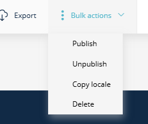
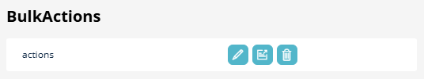

# SuluBulkActionsBundle (Sulu 3.x)

[](https://github.com/manuxi/SuluBulkActionsBundle/blob/3.x/LICENSE)


[🇩🇪 German Version](README.de.md)

Bulk actions for lists in the Sulu admin: mark rows, then publish, unpublish, copy a locale or delete them in one go.
Articles (all groups), snippets, [testimonials](https://github.com/manuxi/SuluTestimonialsBundle) and [events](https://github.com/manuxi/SuluEventBundle) work out of the box with all four actions; other bundles bring their own handler.



This is the `3.x` branch for Sulu 3.0. The `2.x` branch is the version for Sulu 2.6.

## Installation

```console
composer require manuxi/sulu-bulk-actions-bundle:3.x-dev
```

1. Register the bundle in `config/bundles.php`:
   `Manuxi\SuluBulkActionsBundle\SuluBulkActionsBundle::class => ['all' => true]`
2. Import the routes in `config/routes_admin.yaml`:
   ```yaml
   SuluBulkActionsBundle:
       resource: '@SuluBulkActionsBundle/Resources/config/routes_admin.yaml'
   ```
3. Add the JS to `assets/admin/package.json` (`"sulu-bulk-actions-bundle": "file:../../vendor/manuxi/sulu-bulk-actions-bundle/src/Resources/js"`)
   and `assets/admin/app.js` (`import 'sulu-bulk-actions-bundle';`), then `npm install --force && npm run build`.
4. Give the "Bulk actions" context to a role (see Permissions).

## Permissions

Two levels, so nobody can do in bulk what they may not do one by one:

1. **Switch:** the security context `sulu.bulk_actions.actions` ("BulkActions" in the role form) decides whether a role
   may use bulk actions at all. "Live" allows publish and unpublish, "Edit" allows copy locale, "Delete" allows delete
   (unless `delete_enabled` is switched off, see below). Nobody has it by default; give it to a role in the role form.
2. **Entries:** every entry is checked against the security context of the entry itself, with the same permission
   ("Live", "Edit" or "Delete"). For articles that is the context of the article group (`sulu.article.articles_blog`, ...),
   for snippets `sulu.snippet.snippets`, for testimonials and events their own contexts. Copy locale checks "Edit" in the target language. Entries without permission
   are skipped and reported. The dropdown only shows the actions the user may use in that list (for example only in the
   Blog tab if they have the right for Blog).



New article groups need nothing: their contexts already exist in the role form.

## Result

If not all selected entries could be processed, a dialog explains why, in the language of the admin: entries without a
version in the chosen language (detected up front and skipped), entries without permission, and other errors with the
title of the entry. Details: [Result of a bulk action](docs/results.en.md)

## Copy locale

"Copy locale" copies the content of one language into another for all selected articles, snippets, testimonials or events, like "Copy locale"
in the form. A dialog asks for the source and the target language. The result is always a draft; nothing is published.
Entries without the source language and entries that already have the target language are skipped and listed by title;
a switch "Overwrite existing versions" (default: off) replaces existing drafts. Pages have a handler, but no list in
the admin yet (the page tree cannot select). The list of the forms of the [SuluFormBundle](https://github.com/sulu/SuluFormBundle)
gets only this action (forms have neither a draft nor a publication), and only with a version of that bundle whose
`FormManager` has `copyLocale()`. Details: [Copy locale](docs/copy-locale.en.md)

## Delete

"Delete" removes all selected entries after a confirmation. It is offered only to roles that have the "Delete"
permission in the "Bulk actions" context and in the context of the list, and every entry is checked again on the
server. Articles and snippets are removed with the message of Sulu; testimonials and events are put into the trash and
leave the search index and the activity log like they do when deleted in the form.
Details: [Delete](docs/delete.en.md)

## Configuration

```yaml
sulu_bulk_actions:
    delete_enabled: true         # false removes bulk delete for everybody, whatever the roles say
    resources:                   # optional; articles, snippets, testimonials and events are added by default
        articles:
            view_prefixes: ['sulu_article.article.list_']
            actions: [publish, unpublish, copy_locale, delete]
```

A list configured under `resources` replaces the defaults of that resource: add `delete` and `copy_locale` there too.

## Handlers for other resources

Implement `Manuxi\SuluBulkActionsBundle\Handler\BulkActionHandlerInterface` (it is tagged automatically) and add the
resource to `sulu_bulk_actions.resources` with the names of its list views:

```php
public function supports(string $resourceKey, string $action): bool
{
    return 'testimonials' === $resourceKey && \in_array($action, ['publish', 'unpublish'], true);
}

public function handle(string $action, array $ids, string $locale): array
{
    // ... return ['done' => [...ids], 'failed' => [id => message]]
}
```

Also implement `EntryInfoProviderInterface` so that entries without the language are skipped with a clear message and
errors show the title instead of the ID (see [Result of a bulk action](docs/results.en.md#own-handlers)).
`LocaleCopyHandlerInterface` adds the action `copy_locale` (see [Copy locale](docs/copy-locale.en.md#own-handlers)).

## Endpoint

`POST /admin/api/bulk-actions/{resourceKey}/{action}?locale=de` with `{"ids": ["..."]}`. The prefix is deliberately not
`/admin/api/{resourceKey}/...`, which would collide with the routes of the resources themselves. The response counts
`done`, `missing`, `denied` and `failed` entries (see [Result of a bulk action](docs/results.en.md#response-of-the-endpoint)).
`copy_locale` also takes `sourceLocale`, `targetLocale` and `overwrite` (see [Copy locale](docs/copy-locale.en.md#endpoint)).

## Tests

```console
composer install
vendor/bin/phpunit
```
